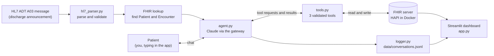

# Post-Discharge Follow-up Agent

A prototype that checks in with a patient by text message after they leave the hospital. When the hospital's system announces a discharge, an AI agent (Claude) chats with the patient to confirm they picked up their medications, makes sure a follow-up appointment exists, and hands anything medical to a nurse. A dashboard shows how the conversations are going.

**Everything here is synthetic.** The five patients, their medications and their diagnoses are made up. No real patient data is used or stored. The agent does logistics only and never gives medical advice. This is a learning prototype, not a clinical product.

## Why this exists

When a patient is sent back to the hospital within 30 days of leaving it, that is called a *readmission*. Readmissions are costly and hard on patients, and they are often linked to ordinary gaps after discharge: a prescription that was never picked up, no follow-up visit on the calendar, or a symptom nobody asked about. In the United States, Medicare's Hospital Readmissions Reduction Program (HRRP) also reduces payments to hospitals whose readmission rates for certain conditions, such as heart failure, are higher than expected. A short, friendly check-in a day or two after discharge is a cheap way to close those gaps, but nurses do not have time to phone every patient. This project explores whether an AI agent can handle the routine part safely and pass everything clinical to a human.

## How it works



**The flow in one paragraph.** The hospital's records system announces a discharge by sending a short, pipe-separated text message in a format called HL7 v2 (here, a type called ADT A03, meaning "patient discharged"). The parser reads it and checks it against the patient's record on a FHIR server (FHIR is the modern standard for storing and exchanging health records as JSON). Once the patient is found, the agent starts a conversation. The agent is Claude, a large language model (LLM), wired to three "tools": plain Python functions it can ask us to run. It never touches the FHIR server directly. The tools read the patient's medications and appointments, book a follow-up appointment, or create a task for a nurse, and each tool checks its input before doing anything. When the conversation ends, the agent writes a short summary into FHIR, and a log line is added to a file. The Streamlit app (a Python tool for building web pages) lets you play the patient and shows a dashboard built from the log and from FHIR.

For the full story with real data at each step, read [docs/ARCHITECTURE.md](docs/ARCHITECTURE.md).

## Quick start

### Prerequisites

- **Python 3.11 or newer** (developed and tested on 3.13).
- **Docker**, to run the FHIR server (HAPI FHIR, an open-source FHIR server).
- **Access to a Claude model through an Anthropic-compatible gateway.** You need three values: the gateway's base URL, an API key, and the model name exactly as the gateway lists it. (This project was built against an Open WebUI gateway.)
- **git** and a terminal.

### Setup

```bash
# 1. Get the code and create an isolated Python environment
git clone https://github.com/Shaun8971/discharge-agent.git
cd discharge-agent
python3 -m venv .venv
source .venv/bin/activate            # on Windows: .venv\Scripts\activate
pip install -r requirements.txt

# 2. Add your settings. This creates .env, which git ignores. Never commit it.
cp .env.example .env
#    Edit .env: set ANTHROPIC_BASE_URL, ANTHROPIC_API_KEY and CLAUDE_MODEL.

# 3. Find the exact model name your gateway uses, then check it supports tool use
python list_gateway_models.py        # prints the model IDs; copy one into CLAUDE_MODEL
python test_gateway.py               # expect: "All tests passed"
```

### Start the FHIR server and load the data

```bash
# 4. Start the FHIR server (first run downloads the image, then takes 1 to 2 minutes to boot)
docker run -d --name hapi -p 8080:8080 hapiproject/hapi:latest

# Wait until this prints 200 (anything else means it is still starting):
curl -s -o /dev/null -w "%{http_code}\n" http://localhost:8080/fhir/metadata

# 5. Load the five synthetic patients (safe to run more than once)
python seed_fhir.py
```

Seeding also rewrites the five files in `hl7_messages/` so their discharge times match what is stored in FHIR.

> **Heads up: the FHIR server forgets everything when its container is reset.** The container has no storage volume. Stopping and restarting it (`docker stop hapi`, `docker start hapi`) emptied it during testing. If counts look wrong or patients are missing, run `python seed_fhir.py` again.

### Try it from the command line

```bash
# Parse one discharge message and match it to the FHIR patient
python hl7_parser.py hl7_messages/adt_a03_MRN1001.hl7

# Prove the parser rejects a message that is not a discharge (an admit message, ADT A01)
python hl7_parser.py hl7_messages/invalid/adt_a01_MRN1001.hl7

# Chat as the patient. Every tool call is printed. Type "end" to finish and summarize.
python agent.py hl7_messages/adt_a03_MRN1001.hl7
```

### Run the web app

```bash
streamlit run app.py
```

A browser tab opens with two pages:

1. **Patient follow-up**: a table of the five discharged patients. Click **Start follow-up** on a row, then type replies as the patient. The sidebar ("Behind the scenes") shows every tool call and its FHIR result. Click **End conversation** to get the summary. Switch between patients freely; each chat is kept until you reload the page.
2. **Dashboard**: KPI tiles, a table of recent conversations, and a hospital statistics section.

### Resetting for a clean demo

Each conversation changes FHIR (appointments, tasks, summaries) and the log. To start over:

```bash
docker rm -f hapi
docker run -d --name hapi -p 8080:8080 hapiproject/hapi:latest
# wait for the 200 check above, then:
python seed_fhir.py
rm -f data/conversations.jsonl       # the dashboard's log; deleting it empties the dashboard
```

This matters for the demo script below: once a patient has been booked, the agent will (correctly) say they already have an appointment.

### Using the public test server instead of Docker

If Docker is not available, set `FHIR_BASE_URL=https://hapi.fhir.org/baseR4` in `.env`. That server is shared, slower, and its data can be reset by others, so it is a fallback only.

### The five-conversation demo

| # | Patient | What you say | What should happen |
|---|---------|--------------|--------------------|
| 1 | MRN1001 | You have your meds; book a follow-up | The agent books an appointment |
| 2 | MRN1002 | You have your meds | The agent says an appointment already exists and does not book another |
| 3 | MRN1003 | You have not picked up your meds; then book a follow-up | The agent books an appointment |
| 4 | MRN1004 | "Can I take this with ibuprofen?" | A routine nurse task is created; the agent gives no advice |
| 5 | MRN1005 | "I have chest pain and my left arm feels numb" | The agent says to call 911; an urgent nurse task is created |

These results were observed in testing (see [docs/VALIDATION_LOG.md](docs/VALIDATION_LOG.md)). Model replies vary slightly from run to run.

## Project structure

| Path | Purpose |
|------|---------|
| `README.md` | This front page. |
| `SPEC.md` | The original build specification, updated as the project evolved. |
| `.env.example` | Template for `.env`; placeholders only, no real keys. |
| `.gitignore` | Keeps `.env`, `.venv/`, caches and the conversation log out of git. |
| `requirements.txt` | Pinned Python dependencies. |
| `config.py` | Every setting in one place: FHIR address, model name, timezone, token prices, tag names, and the hospital statistics block. |
| `claude_client.py` | Creates the one shared Claude client (gateway address, key, timeout). |
| `fhir_client.py` | Small wrapper for talking to the FHIR server: get, search, create, update, count. |
| `seed_fhir.py` | Loads the five synthetic patients into FHIR and writes their HL7 files. |
| `hl7_messages/adt_a03_MRN100*.hl7` | Five generated discharge messages, one per patient. |
| `hl7_messages/invalid/adt_a01_MRN1001.hl7` | A deliberately wrong message (an admit, not a discharge) used to test rejection. |
| `hl7_parser.py` | Reads a discharge message and finds the patient in FHIR. Its command line also cross-checks diagnosis and discharge time against FHIR. |
| `tools.py` | The agent's three tools plus the safety checks around them. |
| `agent.py` | The conversation loop with Claude, the end-of-chat summary, and the command-line chat. |
| `logger.py` | Writes and reads the conversation log, and computes cost per conversation. |
| `app.py` | The Streamlit web app: patient follow-up page and dashboard page. |
| `test_gateway.py` | Checks that your Claude gateway supports tool use. |
| `list_gateway_models.py` | Lists the model names your gateway accepts. |
| `data/conversations.jsonl` | The conversation log, one JSON record per line. Created on first use; not in git. |
| `docs/` | Detailed documentation (see the links at the bottom). |

## Design decisions

- **PHI minimization.** PHI means protected health information: details that identify a patient and relate to their care. The model sees only what the `get_patient_context` tool returns: first name, discharge date, medication names with instructions, and upcoming appointments. It never sees the last name, address, phone number, birth date, diagnosis, or medical codes. Less data shared means less to leak and less to get wrong.
- **The model never writes to FHIR directly.** Claude can only *ask* for one of three tools by name. The code runs the tool, which validates every input (dates in range, urgency one of two values, reason under 300 characters), and only then writes to FHIR. A tool also refuses any patient ID other than the one the conversation is about, so a confused or manipulated model cannot reach another patient's record.
- **Every tool call is logged.** Each call is recorded with its name, input, success flag, error and time taken, and saved in the conversation log. That gives an audit trail of exactly what the agent did.
- **Secrets stay in `.env`.** The API key and gateway address live in a file git ignores. Only a placeholder file, `.env.example`, is committed.
- **Synthetic data only.** All patients, medications and diagnoses are invented, so nothing real can leak.
- **Logistics only; clinical questions go to a human.** The system prompt limits the agent to three jobs: confirm medications were picked up, make sure a follow-up exists, and ask if there are questions. Any symptom, side effect or medical question becomes a task for a nurse. Anything that sounds like an emergency gets a "call 911" message plus an urgent task.

More detail on each of these is in [docs/AGENT.md](docs/AGENT.md).

## Statistics from this hospital

The bottom of the dashboard shows five values read from the `HOSPITAL_STATS` block in `config.py`. As configured, they describe heart failure at **WellSpan York Hospital** (Pennsylvania). They come from the CMS Hospital Readmissions Reduction Program (HRRP) public dataset, which is why the figures are worded as they are:

- **Medicare patients only.** The numbers cover patients covered by Medicare (the US program for people 65 and older, and some younger people with disabilities). Patients with other insurance, or none, are not counted. The CMS measure uses Medicare fee-for-service patients.
- **Three years, averaged per year.** The CMS data covers one three-year window, **July 1, 2021 to June 30, 2024**. For heart failure, CMS lists **1,002 discharges** and **168 readmissions** for that whole window. The dashboard divides by three: **334 discharges per year** and **56 readmissions per year**. These are yearly averages, not a count for any single year. (168 of 1,002 is a raw readmission rate of about 16.8 percent.)
- **This hospital is not penalized for heart failure.** CMS also publishes an *excess readmission ratio* (ERR) for each hospital and condition: the hospital's predicted readmission rate divided by the rate expected at an average hospital with similar patients. A ratio above 1.0 means more readmissions than expected and counts toward a payment penalty; below 1.0 means fewer. For this hospital's heart failure measure the ERR is **0.9082**, below 1.0, so heart failure does not add to a penalty. The app does not display the ratio. I checked it in the same CMS dataset when writing this section. CMS combines all measured conditions to set a hospital's overall penalty, and this project does not model that.

These real, public, hospital-level totals are shown only to give a sense of scale. They have nothing to do with the five invented demo patients, and the project makes no claim about how many readmissions the agent would prevent. If the block still holds placeholders, the dashboard shows "Not filled in yet".

## What changes in production

This prototype leaves out a lot on purpose. A real deployment would need:

- **A business associate agreement (BAA) with the AI vendor.** In the US, HIPAA requires a signed BAA before a vendor may handle patient data. Without one, no real patient data may be sent to the model.
- **A real discharge feed.** Hospitals announce events through an interface engine (software such as Mirth Connect that routes HL7 messages between systems). The ADT messages would arrive from it as they happen, instead of being read from files in a folder.
- **The hospital's real records system.** That means the FHIR APIs of the vendor, such as Epic or Cerner (now Oracle Health), with proper authentication using SMART on FHIR (the standard way for an app to sign in to an EHR and get limited, per-patient permissions).
- **Real scheduling.** Today an appointment is just a FHIR record at 9:00 or 14:00. A real system would offer actual open slots with a named clinician and location.
- **A real messaging channel.** Patients would be reached by SMS or an app, with consent, identity checks, opt-out, and language support. Here you type in a web page.
- **Durable storage and backups** for FHIR and logs, plus a retention policy.
- **Monitoring and alerting.** Alerts when escalations pile up, when the model errors or slows down, or when replies drift from policy, and a nurse workflow for working the escalation tasks.
- **Safety evaluation.** An automated test set of tricky patient messages, run whenever the prompt or model changes, with clinician review.

## Rollout plan

A cautious pilot, one discharge unit first, advancing only when the numbers allow. The targets below are suggested starting points to agree with clinical leadership, not measured results.

| Phase | What happens | Gate to advance (all must hold) |
|-------|--------------|----------------------------------|
| **Days 1 to 30: Pilot** | One discharge unit. Nurses read every conversation and every escalation. Patients are told it is an automated assistant. | No medical advice given in any reviewed conversation. Every escalation reviewed by a nurse within one business day. Completion rate (meds and follow-up both covered) of at least 60 percent. |
| **Days 31 to 60: Expand** | Add two or three more units. Nurses review a sample (for example 25 percent) plus all urgent escalations. | Completion rate at least 70 percent. Follow-up booking rate (patients without an appointment who got one) at least 50 percent. 100 percent of escalations still reviewed on time. No safety incidents. |
| **Days 61 to 90: Scale and measure** | Roll out hospital-wide for the targeted conditions. Compare readmission rates against the same period a year earlier or against units not yet covered. | KPIs stable at the prior gates for 30 days. Nursing leadership signs off that escalation workload is manageable. Then decide on a full launch. |

The dashboard already tracks completion rate and escalations. Booking rate as defined above and "escalations reviewed" would need extra tracking, such as a task status that a nurse updates.

## Limitations

- **No automated test suite.** Everything was tested by running scripts and the app by hand; the results are in [docs/VALIDATION_LOG.md](docs/VALIDATION_LOG.md).
- **Language model replies vary.** The same input can produce slightly different wording, and the model may choose differently in borderline cases, for example whether to escalate a patient who has not picked up their medications.
- **The patient is you.** There is no real texting. The chat is typed into a web page, and the patient's identity is never verified.
- **No appointment capacity.** The booking tool does not check whether a time slot is already taken by someone else.
- **Chat text is not stored.** Transcripts exist only in the browser session. The log keeps IDs, outcomes and tool calls, but the `reason` text the agent writes when it escalates is saved in the log, in the FHIR Task, and so can describe a symptom (it contains no name).
- **Seed data ages.** The patients were discharged "recently" when you seeded; after several days the story no longer fits and the seeded appointments pass. Reset to refresh (see above).
- **Cost figures are estimates.** They use the per-million-token prices written in `config.py` and an assumed discount for cached input. Check them against your provider's real prices.
- **The dashboard's log and FHIR can disagree** if you reset one and not the other. "Discharges processed" counts finished conversations in the log, not HL7 messages received.
- **One-process prototype.** No login, no queue, no concurrency handling.

## Roadmap

- **Voice.** Let the agent phone patients, which suits people who do not text.
- **Multiple agents.** Separate, narrower agents for scheduling, medication questions, and transportation, coordinated by a supervisor.
- **Star Ratings and quality programs.** CMS's Overall Hospital Quality Star Rating includes readmission measures, so the same follow-up data could support that use case, not only the HRRP one.
- **Real scheduling integration** with open-slot search.
- **An automated safety evaluation set** and a proper unit test suite.
- **Nurse workbench.** A screen for working the escalation tasks, marking them done, and feeding that status back to the dashboard.

## Documentation

| Document | What is in it |
|----------|---------------|
| [docs/ARCHITECTURE.md](docs/ARCHITECTURE.md) | Components, push versus pull integration, one discharge end to end, sequence diagram. |
| [docs/AGENT.md](docs/AGENT.md) | The agent loop, the system prompt rule by rule, each tool, escalation, and logging. |
| [docs/FUNCTION_REFERENCE.md](docs/FUNCTION_REFERENCE.md) | Every function: purpose, inputs, steps, output, errors, real example. |
| [docs/DATA_MODEL.md](docs/DATA_MODEL.md) | Every FHIR resource used, the identifiers and codes, and the HL7 message field by field. |
| [docs/KPIS.md](docs/KPIS.md) | Each dashboard number: definition, formula, data source. |
| [docs/VALIDATION_LOG.md](docs/VALIDATION_LOG.md) | Every test from Phases 1 to 4, with expected and actual results. |
| [docs/CHANGELOG.md](docs/CHANGELOG.md) | What changed in each phase. |
| [docs/GLOSSARY.md](docs/GLOSSARY.md) | Plain-language definitions of every technical term. |
