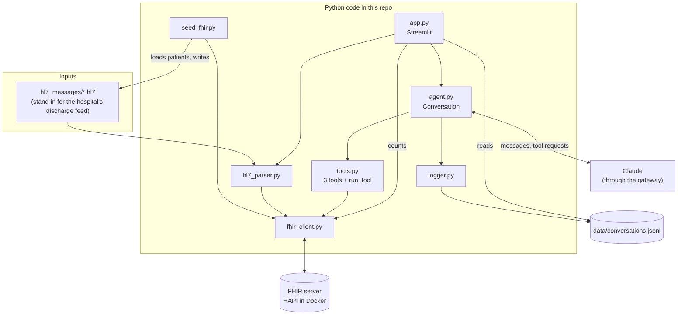
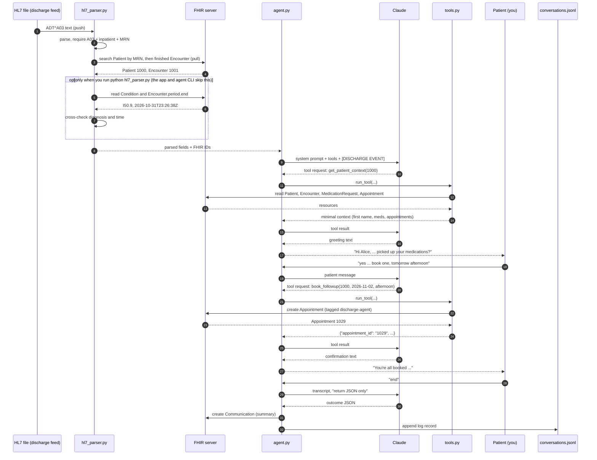

# Architecture

This document explains how the pieces fit together and then follows one real discharge from start to finish. New terms are defined where they first appear; [GLOSSARY.md](GLOSSARY.md) collects them all. Back to the [README](../README.md).

## The big picture



## Components and what each one does

**FHIR server (HAPI FHIR in Docker).** FHIR (Fast Healthcare Interoperability Resources) is the modern standard for health records as JSON, reached over ordinary web requests. Each kind of record is a *resource* (Patient, Encounter, Appointment, and so on) with its own web address, such as `/fhir/Patient/1000`. HAPI is a free, open-source FHIR server, and Docker is a tool that runs it in a self-contained box called a container. In this project the FHIR server is the **system of record**: the one place that holds the truth about patients, medications, appointments and nurse tasks. It has no storage volume, so resetting the container empties it.

**HL7 messages (`hl7_messages/`).** HL7 v2 is the older, pipe-delimited text format that hospital systems still use to announce events. An *ADT* message is one about admissions, discharges and transfers, and *A03* is the specific event "patient discharged". Each file holds five lines (segments): MSH (header), EVN (event), PID (patient), PV1 (visit) and DG1 (diagnosis). In a real hospital these arrive over a network; here five files stand in for them. [DATA_MODEL.md](DATA_MODEL.md) explains every field.

**Seed script (`seed_fhir.py`).** Creates the five synthetic patients and everything attached to them in FHIR, and writes their HL7 files. It is *idempotent* (safe to run repeatedly, with no duplicates) and it is the single source of discharge times, so the HL7 files and FHIR always agree.

**Parser (`hl7_parser.py`).** Reads a discharge message, rejects anything that is not a valid inpatient ADT A03, finds the matching patient and most recent finished hospital stay in FHIR, and, when run from its command line, cross-checks the message's diagnosis code and discharge time against FHIR. The app and the agent's command-line chat call only the parsing and lookup steps, not the cross-checks.

**FHIR client (`fhir_client.py`).** A thin helper that turns "get this resource", "search for these", "create this" and "count these" into web requests, and raises a clear error if the server complains.

**Claude client (`claude_client.py`).** Builds the single connection to the AI model through the gateway (a web service in front of the model that speaks Anthropic's API). Everything that talks to Claude imports it from here.

**Agent (`agent.py`).** The conversation engine. A `Conversation` object keeps the message history, sends it to Claude together with the list of tools, runs any tools Claude asks for, and repeats until Claude answers in plain text. At the end it asks Claude for a structured summary, saves it to FHIR, and writes a log line. The same file also holds the command-line chat. See [AGENT.md](AGENT.md).

**Tools (`tools.py`).** Three Python functions the agent may request: `get_patient_context`, `book_followup`, `escalate_to_nurse`. Each validates its input and returns a small result. `run_tool` wraps them so a bad request becomes an error message for the model instead of a crash, and it only allows the current patient's ID.

**Logger (`logger.py`).** Appends one JSON record per finished conversation to `data/conversations.jsonl` (JSONL: one JSON object per line), reads them back, and prices them.

**Streamlit app (`app.py`).** Streamlit turns a Python script into a web page. Page 1 lists the patients, runs chats and shows every tool call in a sidebar. Page 2 is the dashboard. It reads the log for most numbers and asks FHIR directly for the agent's appointments and tasks.

**Configuration (`config.py`).** Addresses, names, the timezone, token prices, and the hospital statistics block, in one file. Secrets live in `.env`, never in code.

## Push versus pull: two integration styles in one project

Systems can exchange information in two ways, and this project uses one of each.

- **Push (HL7).** The source system sends a message the moment something happens, without being asked. The receiver does not ask "has anyone been discharged?"; the discharge announcement simply arrives. HL7 v2 messages work this way. In this prototype, reading a file from `hl7_messages/` plays the part of a message arriving.
- **Pull (FHIR).** The receiver asks for exactly the data it needs, when it needs it, by calling a web address and getting JSON back. FHIR works this way. After the discharge message arrives, the code pulls the patient, the stay, the medications and the appointments.

Why use both? The pushed message is small and tells you *that something happened and to whom*. The FHIR server is the current, complete record, so the code pulls details from it instead of trusting a small message to carry everything. The parser then compares the two sources (diagnosis code and discharge time), which is a cheap way to catch mismatched or stale data.

## One discharge, end to end

This walk uses the real data from the demo conversation for **MRN1001** (a made-up patient, Alice Morgan). IDs such as `1000` are assigned by the FHIR server and may differ on your machine after a reset.

### Step 1. The discharge message arrives

`hl7_messages/adt_a03_MRN1001.hl7` contains:

```
MSH|^~\&|DEMO_EHR|DEMO_GENERAL|DISCHARGE_AGENT|DEMO_GENERAL|20261031232638+0000||ADT^A03^ADT_A03|CTRL-MRN1001-001|P|2.5
EVN|A03|20261031232638+0000
PID|1||MRN1001^^^DEMO^MR||Morgan^Alice||19500314
PV1|1|I|3WEST^301^A||||||||||||||||||||||||||||||||||||||||||20261031232638+0000
DG1|1|I10|I50.9^Heart failure, unspecified^I10||20261031232638+0000|F
```

Translation: "Message type ADT^A03 (discharge), ID `CTRL-MRN1001-001`. Patient `MRN1001`, Morgan, Alice, born 1950-03-14. Inpatient visit, discharged 2026-10-31 at 23:26:38 UTC. Final diagnosis ICD-10-CM `I50.9`, heart failure, unspecified."

### Step 2. The parser reads it

`parse_adt` converts line endings to the carriage return the HL7 library requires, checks the message is `ADT^A03`, that the visit class is `I` (inpatient), and that an MRN is present. It returns:

```
message_control_id  CTRL-MRN1001-001
event_type          ADT^A03
mrn                 MRN1001
patient_name        Alice Morgan
discharge_time      2026-10-31T23:26:38+00:00
diagnosis_code      I50.9
```

### Step 3. The code looks the patient up in FHIR (a pull)

`find_patient("MRN1001")` makes two searches:

1. `GET /fhir/Patient?identifier=urn:demo:mrn|MRN1001` finds one Patient, ID **1000**. (`urn:demo:mrn` names the numbering scheme the MRN belongs to, so "MRN1001" is unambiguous.)
2. `GET /fhir/Encounter?subject=Patient/1000&status=finished` finds the finished hospital stay, Encounter **1001**.

When you run the parser's command line (`python hl7_parser.py <file>`), it then also checks that FHIR's Condition for Encounter 1001 has code `I50.9` (it does) and that the Encounter's `period.end`, `2026-10-31T23:26:38Z`, equals the message's discharge time within 5 minutes (it does).

### Step 4. The agent starts

`Conversation.start()` sends Claude the system prompt, the three tool definitions, and one hidden first message that the patient never sees:

```
[DISCHARGE EVENT] patient_id=1000, discharged=2026-10-31T23:26:38+00:00. Begin the follow-up check-in.
```

### Step 5. Claude asks for the patient's context (a tool call)

Claude replies not with text but with a *tool request*: "run `get_patient_context` with `patient_id` 1000". The code runs it through `run_tool`, which makes several FHIR reads (the Patient, the finished Encounters, the active MedicationRequests, the booked Appointments) and returns only this:

```json
{"first_name": "Alice", "discharge_date": "2026-10-31",
 "medications": [
   {"name": "Metoprolol 25 mg tablet", "instruction": "Take 1 tablet by mouth twice daily"},
   {"name": "Furosemide 40 mg tablet", "instruction": "Take 1 tablet by mouth every morning"},
   {"name": "Lisinopril 10 mg tablet", "instruction": "Take 1 tablet by mouth once daily"}],
 "upcoming_appointments": []}
```

Note what is absent: last name, address, phone, birth date, diagnosis, drug codes. The code sends this back to Claude as a *tool result*.

### Step 6. The agent greets the patient

Claude, now holding the context, answers in text:

> Hi Alice, this is Demo General Hospital checking in after your discharge. I'm here to help with a few logistics. Have you picked up all three of your medications: Metoprolol 25 mg, Furosemide 40 mg, and Lisinopril 10 mg?

### Step 7. The patient replies, and the agent books a follow-up

The patient types "yes I picked up all of them". Claude notices `upcoming_appointments` is empty and offers to book one. The patient says "yes please book one, tomorrow afternoon". Claude requests:

```
book_followup {"patient_id": "1000", "date": "2026-11-02", "time_of_day": "afternoon"}
```

`book_followup` checks the date is 1 to 14 days away, the time of day is valid, and the patient has no upcoming appointment, then creates an **Appointment** in FHIR (status `booked`, 30 minutes starting 14:00 hospital time, the patient as a participant, and the tag `urn:demo:source|discharge-agent`). It returns:

```json
{"appointment_id": "1029", "date": "2026-11-02", "time": "14:00", "status": "booked"}
```

Claude confirms: "You're all booked, Alice. Your follow-up is tomorrow, November 2, at 2:00 PM (30 minutes)." (If the patient had mentioned a symptom instead, Claude would call `escalate_to_nurse` and a **Task** would be created. See [AGENT.md](AGENT.md).)

### Step 8. The conversation ends

The patient says there is nothing else. Typing `end` (CLI) or clicking **End conversation** (app) calls `Conversation.end()`, which:

1. Makes one extra Claude call that returns only JSON. For this run:
   ```json
   {"completed": true, "meds_confirmed": "yes", "followup": "booked", "escalated": false,
    "summary": "The patient confirmed they had picked up all three of their prescribed medications. The assistant booked a follow-up appointment for the afternoon of November 2 at 2:00 PM, and the patient had no further questions. No escalation to a nurse was needed."}
   ```
2. Overrides two fields with facts from the tool log (`escalated`, and `followup` = `booked` because `book_followup` succeeded), and removes the first name from the summary if present.
3. Writes a **Communication** (a record that a contact took place) to FHIR with that summary, ID `1030`.
4. Appends one line to `data/conversations.jsonl`: the IDs, 7 Claude calls, 24 fresh input tokens, 6,086 cache-write tokens, 5,717 cache-read tokens, 551 output tokens, the tool calls with timing, and the outcome. No patient name and no chat transcript.

### Step 9. The dashboard updates

The next time the dashboard is refreshed, "Discharges processed" counts one more log record, "Follow-ups booked (FHIR)" counts the new Appointment, and the cost tile includes this conversation's price: (24 + 6,086 x 1.25 + 5,717 x 0.10) x $2 + 551 x $10, divided by one million, which is about **$0.0219**. See [KPIS.md](KPIS.md).

## Sequence diagram



## Where to go next

- The agent's loop, prompt and tools in depth: [AGENT.md](AGENT.md)
- Every FHIR resource and the HL7 message field by field: [DATA_MODEL.md](DATA_MODEL.md)
- Every function: [FUNCTION_REFERENCE.md](FUNCTION_REFERENCE.md)
