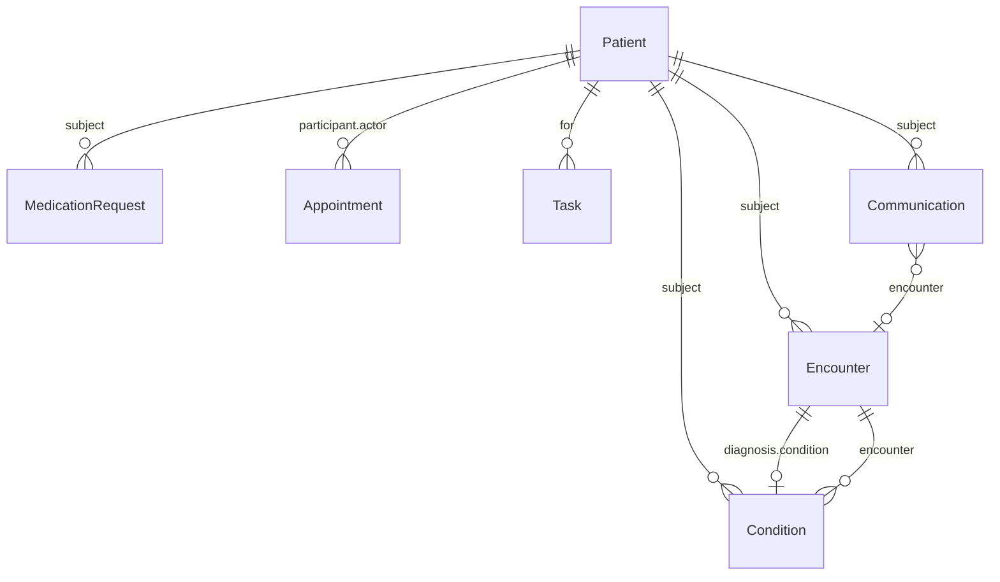

# Data Model

Every FHIR resource the project uses, the identifiers and code systems that tie them together, and the HL7 discharge message field by field. All examples are real output from the running FHIR server (patient data is synthetic). IDs like `1000` are assigned by the server and will differ on your machine after a reset. New terms are defined where they first appear; see [GLOSSARY.md](GLOSSARY.md). Back to the [README](../README.md).

## 1. How the resources connect

A FHIR *resource* is one kind of record in JSON. Resources point at each other with a *reference* such as `"reference": "Patient/1000"`, meaning "the Patient whose ID is 1000".



| Resource | Created by | Role in this project |
|----------|-----------|----------------------|
| Patient | seed script | The person. |
| Encounter | seed script | The hospital stay that just ended. |
| Condition | seed script | The discharge diagnosis (ICD-10-CM). |
| MedicationRequest | seed script | One prescribed medication (RxNorm). |
| Appointment | seed script (2 patients) and the agent (`book_followup`) | A booked follow-up visit. |
| Task | the agent (`escalate_to_nurse`) | A request for a nurse to follow up. |
| Communication | the agent (end of conversation) | The conversation summary. |

## 2. Identifiers, tags and code systems

An *identifier* is a labelled ID. It has a *system* (which numbering scheme it belongs to, written as a web address or a URN, a name-style identifier) and a *value*. A *tag* in `meta.tag` is a label attached to a resource that you can search by.

| Name | System | Values | Used for |
|------|--------|--------|----------|
| Medical record number (MRN) | `urn:demo:mrn` | `MRN1001` to `MRN1005` | The key linking an HL7 message to a FHIR Patient. Searched as `identifier=urn:demo:mrn\|MRN1001`. |
| Source tag | `urn:demo:source` | `seed` or `discharge-agent` | `seed` marks seeded data. `discharge-agent` marks everything the agent creates; the dashboard counts agent activity by searching for it. |
| Seed ID | `urn:demo:seed-id` | for example `MRN1001-ENC`, `MRN1001-DX`, `MRN1001-MED1`, `MRN1002-APPT` | Lets the seed script find a resource it created earlier, so reruns add no duplicates. |
| RxNorm | `http://www.nlm.nih.gov/research/umls/rxnorm` | codes below | Standard US drug codes. |
| ICD-10-CM | `http://hl7.org/fhir/sid/icd-10-cm` | codes below | Standard US diagnosis codes. |

**RxNorm** is the US National Library of Medicine's drug vocabulary. Each code (an *RxCUI*) names one exact drug, strength and form. All twelve below are at the "semantic clinical drug" level (ingredient, strength, dose form) and were checked against NLM's RxNav service.

| MRN | Medication (plain text) | RxNorm code | RxNorm name |
|-----|-------------------------|-------------|-------------|
| MRN1001 | Metoprolol 25 mg tablet | 866924 | metoprolol tartrate 25 MG Oral Tablet |
| MRN1001 | Furosemide 40 mg tablet | 313988 | furosemide 40 MG Oral Tablet |
| MRN1001 | Lisinopril 10 mg tablet | 314076 | lisinopril 10 MG Oral Tablet |
| MRN1002 | Carvedilol 6.25 mg tablet | 200031 | carvedilol 6.25 MG Oral Tablet |
| MRN1002 | Spironolactone 25 mg tablet | 313096 | spironolactone 25 MG Oral Tablet |
| MRN1003 | Atorvastatin 40 mg tablet | 617311 | atorvastatin 40 MG Oral Tablet |
| MRN1003 | Aspirin 81 mg tablet | 243670 | aspirin 81 MG Oral Tablet |
| MRN1003 | Clopidogrel 75 mg tablet | 309362 | clopidogrel 75 MG Oral Tablet |
| MRN1004 | Warfarin 5 mg tablet | 855332 | warfarin sodium 5 MG Oral Tablet |
| MRN1004 | Metformin 500 mg tablet | 861007 | metformin hydrochloride 500 MG Oral Tablet |
| MRN1005 | Amlodipine 5 mg tablet | 197361 | amlodipine 5 MG Oral Tablet |
| MRN1005 | Losartan 50 mg tablet | 979492 | losartan potassium 50 MG Oral Tablet |

**ICD-10-CM** is the US diagnosis code set used for billing and records. The five diagnoses come from conditions in the CMS readmission program (heart failure, heart attack, pneumonia, COPD).

| MRN | ICD-10-CM | Meaning |
|-----|-----------|---------|
| MRN1001 | I50.9 | Heart failure, unspecified |
| MRN1002 | I50.22 | Chronic systolic (congestive) heart failure |
| MRN1003 | I21.4 | Non-ST elevation (NSTEMI) myocardial infarction |
| MRN1004 | J18.9 | Pneumonia, unspecified organism |
| MRN1005 | J44.1 | Chronic obstructive pulmonary disease with (acute) exacerbation |

The medications for MRN1004 and MRN1005 are not chosen to match their diagnoses; the data is synthetic and the agent never sees the diagnosis anyway. The agent sees neither code system. It receives only the plain `text` of each medication.

## 3. The resources, with real examples

`meta` on every resource holds server bookkeeping (`lastUpdated`, the time of the last change) and the source tag.

### 3.1 Patient

A person. Created with a *conditional update* on the MRN, so the same MRN always maps to the same record.

```json
{
  "resourceType": "Patient",
  "id": "1000",
  "meta": {
    "lastUpdated": "2026-11-01T19:26:38.220+00:00",
    "tag": [
      {
        "system": "urn:demo:source",
        "code": "seed"
      }
    ]
  },
  "identifier": [
    {
      "system": "urn:demo:mrn",
      "value": "MRN1001"
    }
  ],
  "name": [
    {
      "use": "official",
      "family": "Morgan",
      "given": [
        "Alice"
      ]
    }
  ],
  "telecom": [
    {
      "system": "phone",
      "value": "555-0101",
      "use": "mobile"
    }
  ],
  "birthDate": "1950-03-14",
  "address": [
    {
      "line": [
        "12 Elm St"
      ],
      "city": "Springfield-on-Demo",
      "state": "ZZ",
      "postalCode": "00000"
    }
  ]
}
```

| Field | Meaning |
|-------|---------|
| `id` | The server-assigned ID used in all references (`Patient/1000`). |
| `identifier` | The MRN (system `urn:demo:mrn`). |
| `name` | `family` and `given` names; `use: official` marks the legal name. |
| `telecom` | Phone number (a 555 number, never real). |
| `birthDate` | Date of birth. |
| `address` | A made-up address in a made-up town. |

The agent sees none of this except the first given name.

### 3.2 Encounter

One hospital stay. `status: finished` means it is over; `period.end` is the discharge time, and it is the **single source of truth for discharge times** in this project.

```json
{
  "resourceType": "Encounter",
  "id": "1001",
  "meta": {
    "lastUpdated": "2026-11-01T19:26:38.772+00:00",
    "tag": [
      {
        "system": "urn:demo:source",
        "code": "seed"
      }
    ]
  },
  "identifier": [
    {
      "system": "urn:demo:seed-id",
      "value": "MRN1001-ENC"
    }
  ],
  "status": "finished",
  "class": {
    "system": "http://terminology.hl7.org/CodeSystem/v3-ActCode",
    "code": "IMP",
    "display": "inpatient encounter"
  },
  "subject": {
    "reference": "Patient/1000"
  },
  "period": {
    "start": "2026-10-27T23:26:38Z",
    "end": "2026-10-31T23:26:38Z"
  },
  "diagnosis": [
    {
      "condition": {
        "reference": "Condition/1002"
      },
      "use": {
        "coding": [
          {
            "system": "http://terminology.hl7.org/CodeSystem/diagnosis-role",
            "code": "DD",
            "display": "Discharge diagnosis"
          }
        ]
      },
      "rank": 1
    }
  ]
}
```

| Field | Meaning |
|-------|---------|
| `identifier` | Seed ID `MRN1001-ENC`. |
| `status` | `finished`: the stay has ended. |
| `class` | `IMP` = inpatient (admitted overnight or longer), from the HL7 v3 ActCode list. |
| `subject` | Reference to the Patient. |
| `period` | `start` (4 days before discharge) and `end` (discharge), in UTC. |
| `diagnosis` | Points to the Condition. `use` code `DD` means *discharge diagnosis*, from the diagnosis-role list. `rank: 1` marks the main one. |

### 3.3 Condition

A diagnosis.

```json
{
  "resourceType": "Condition",
  "id": "1002",
  "meta": {
    "lastUpdated": "2026-11-01T19:26:38.664+00:00",
    "tag": [
      {
        "system": "urn:demo:source",
        "code": "seed"
      }
    ]
  },
  "identifier": [
    {
      "system": "urn:demo:seed-id",
      "value": "MRN1001-DX"
    }
  ],
  "clinicalStatus": {
    "coding": [
      {
        "system": "http://terminology.hl7.org/CodeSystem/condition-clinical",
        "code": "active"
      }
    ]
  },
  "verificationStatus": {
    "coding": [
      {
        "system": "http://terminology.hl7.org/CodeSystem/condition-ver-status",
        "code": "confirmed"
      }
    ]
  },
  "category": [
    {
      "coding": [
        {
          "system": "http://terminology.hl7.org/CodeSystem/condition-category",
          "code": "encounter-diagnosis"
        }
      ]
    }
  ],
  "code": {
    "coding": [
      {
        "system": "http://hl7.org/fhir/sid/icd-10-cm",
        "code": "I50.9",
        "display": "Heart failure, unspecified"
      }
    ],
    "text": "Heart failure, unspecified"
  },
  "subject": {
    "reference": "Patient/1000"
  },
  "encounter": {
    "reference": "Encounter/1001"
  }
}
```

| Field | Meaning |
|-------|---------|
| `clinicalStatus` | `active`: the condition is currently present. |
| `verificationStatus` | `confirmed`: a clinician has confirmed it. |
| `category` | `encounter-diagnosis`: a diagnosis made during a stay. |
| `code` | The ICD-10-CM code (`I50.9`) and its description. |
| `subject`, `encounter` | The Patient and the Encounter it belongs to. |

The parser's command line compares this code with the HL7 message's DG1-3.

### 3.4 MedicationRequest

A prescription order, one per medication.

```json
{
  "resourceType": "MedicationRequest",
  "id": "1003",
  "meta": {
    "lastUpdated": "2026-11-01T19:26:38.877+00:00",
    "tag": [
      {
        "system": "urn:demo:source",
        "code": "seed"
      }
    ]
  },
  "identifier": [
    {
      "system": "urn:demo:seed-id",
      "value": "MRN1001-MED1"
    }
  ],
  "status": "active",
  "intent": "order",
  "medicationCodeableConcept": {
    "coding": [
      {
        "system": "http://www.nlm.nih.gov/research/umls/rxnorm",
        "code": "866924",
        "display": "metoprolol tartrate 25 MG Oral Tablet"
      }
    ],
    "text": "Metoprolol 25 mg tablet"
  },
  "subject": {
    "reference": "Patient/1000"
  },
  "dosageInstruction": [
    {
      "text": "Take 1 tablet by mouth twice daily"
    }
  ]
}
```

| Field | Meaning |
|-------|---------|
| `status: active`, `intent: order` | A current order, not a suggestion or a past one. |
| `medicationCodeableConcept` | The drug. `coding` is the exact RxNorm code and name; `text` is the plain name the agent reads out. |
| `subject` | The Patient. |
| `dosageInstruction[0].text` | The patient-facing instructions, also given to the agent. |

### 3.5 Appointment (seeded)

Two patients (MRN1002 and MRN1004) start with a booked follow-up so the agent can be seen confirming an existing one. The seeded time is 10:00 hospital time (shown here in UTC: 15:00Z during US Eastern standard time), five days after the seed run.

```json
{
  "resourceType": "Appointment",
  "id": "1011",
  "meta": {
    "lastUpdated": "2026-11-01T19:26:39.324+00:00",
    "tag": [
      {
        "system": "urn:demo:source",
        "code": "seed"
      }
    ]
  },
  "identifier": [
    {
      "system": "urn:demo:seed-id",
      "value": "MRN1002-APPT"
    }
  ],
  "status": "booked",
  "description": "Post-discharge follow-up",
  "start": "2026-11-06T15:00:00Z",
  "end": "2026-11-06T15:30:00Z",
  "participant": [
    {
      "actor": {
        "reference": "Patient/1006"
      },
      "status": "accepted"
    }
  ]
}
```

### 3.6 Appointment (created by the agent)

From the MRN1003 demo. Note the tag and the local-time offset (`-05:00`).

```json
{
  "resourceType": "Appointment",
  "id": "1032",
  "meta": {
    "lastUpdated": "2026-11-01T19:27:50.124+00:00",
    "tag": [
      {
        "system": "urn:demo:source",
        "code": "discharge-agent"
      }
    ]
  },
  "status": "booked",
  "description": "Post-discharge follow-up",
  "start": "2026-11-02T09:00:00-05:00",
  "end": "2026-11-02T09:30:00-05:00",
  "participant": [
    {
      "actor": {
        "reference": "Patient/1012"
      },
      "status": "accepted"
    }
  ]
}
```

| Field | Meaning |
|-------|---------|
| `status: booked` | Confirmed (other FHIR states include `proposed`, `cancelled`). |
| `description` | "Post-discharge follow-up". |
| `start`, `end` | 30 minutes, at 09:00 (morning) or 14:00 (afternoon) hospital time. |
| `participant` | Who attends. Here only the patient (`status: accepted`). **No clinician, room or clinic is attached**, and nothing checks whether the slot is free. |
| `meta.tag` | `urn:demo:source\|discharge-agent`. The dashboard's "Follow-ups booked" counts these. |

### 3.7 Task

A request for someone to do something. Here it means "a nurse should follow up". From the chest pain demo (MRN1005).

```json
{
  "resourceType": "Task",
  "id": "1036",
  "meta": {
    "lastUpdated": "2026-11-01T19:28:18.598+00:00",
    "tag": [
      {
        "system": "urn:demo:source",
        "code": "discharge-agent"
      }
    ]
  },
  "status": "requested",
  "intent": "order",
  "priority": "urgent",
  "description": "Patient reports chest pain and left arm numbness after discharge on 2026-11-01. Possible emergency. Told to call 911.",
  "for": {
    "reference": "Patient/1024"
  },
  "authoredOn": "2026-11-01T19:28:18Z"
}
```

| Field | Meaning |
|-------|---------|
| `status: requested` | Waiting to be picked up. A nurse workflow would later move it to `in-progress` and `completed`; this prototype has no such screen. |
| `intent: order` | A direct request. |
| `priority` | `routine` or `urgent`; the dashboard splits escalations on this. |
| `description` | The reason the agent wrote (max 300 characters). It can describe a symptom but contains no name. |
| `for` | The Patient the task is about. |
| `authoredOn` | When the agent created it. |

### 3.8 Communication

A record that a contact happened. Here: the end-of-conversation summary. From the same chest pain demo.

```json
{
  "resourceType": "Communication",
  "id": "1037",
  "meta": {
    "lastUpdated": "2026-11-01T19:28:21.362+00:00",
    "tag": [
      {
        "system": "urn:demo:source",
        "code": "discharge-agent"
      }
    ]
  },
  "status": "completed",
  "subject": {
    "reference": "Patient/1024"
  },
  "encounter": {
    "reference": "Encounter/1025"
  },
  "sent": "2026-11-01T19:28:21Z",
  "payload": [
    {
      "contentString": "The patient confirmed they have both prescribed medications. When asked about a follow-up appointment, the patient reported chest pain and left arm numbness, so the assistant escalated urgently to a nurse and told the patient to call 911. No follow-up appointment was booked."
    }
  ]
}
```

| Field | Meaning |
|-------|---------|
| `status: completed` | The contact took place. |
| `subject`, `encounter` | The Patient and the stay being followed up. |
| `sent` | When the summary was written. |
| `payload[0].contentString` | The 2 to 3 sentence summary, with the patient's first name removed. |

## 4. The HL7 ADT^A03 message

HL7 v2 is a pipe-delimited text format. A message is several lines, each a *segment* named by its first three letters. Each segment is split into numbered *fields* by `|`, and a field can be split into *components* by `^`. By convention a field is written as SEGMENT-NUMBER, so "PV1-45" is field 45 of the PV1 segment. This project uses HL7 version 2.5.

A real message (`hl7_messages/adt_a03_MRN1001.hl7`; lines are separated by a carriage return on disk, shown here on separate lines):

```
MSH|^~\&|DEMO_EHR|DEMO_GENERAL|DISCHARGE_AGENT|DEMO_GENERAL|20261031232638+0000||ADT^A03^ADT_A03|CTRL-MRN1001-001|P|2.5
EVN|A03|20261031232638+0000
PID|1||MRN1001^^^DEMO^MR||Morgan^Alice||19500314
PV1|1|I|3WEST^301^A||||||||||||||||||||||||||||||||||||||||||20261031232638+0000
DG1|1|I10|I50.9^Heart failure, unspecified^I10||20261031232638+0000|F
```

The "Read?" column says whether `hl7_parser.py` uses the field. The others are written by the seed script to make the message realistic.

### MSH: message header

| Field | Value | Meaning | Read? |
|-------|-------|---------|-------|
| MSH-1 | `\|` | The field separator itself (the pipe character). | (structural) |
| MSH-2 | `^~\&` | The other separators: component `^`, repeat `~`, escape `\`, sub-component `&`. | (structural) |
| MSH-3 | `DEMO_EHR` | Sending application (the made-up records system). | no |
| MSH-4 | `DEMO_GENERAL` | Sending facility (the made-up hospital). | no |
| MSH-5 | `DISCHARGE_AGENT` | Receiving application (this project). | no |
| MSH-6 | `DEMO_GENERAL` | Receiving facility. | no |
| MSH-7 | `20261031232638+0000` | When the message was created: YYYYMMDDHHMMSS then a UTC offset. | no |
| MSH-9 | `ADT^A03^ADT_A03` | Message type: ADT (admit, discharge, transfer), event A03 (discharge), structure ADT_A03. **The parser rejects anything that is not ADT then A03.** | yes |
| MSH-10 | `CTRL-MRN1001-001` | Message control ID: a unique ID for this message so receivers can spot duplicates. | yes |
| MSH-11 | `P` | Processing ID: P = production (as opposed to T = test). | no |
| MSH-12 | `2.5` | HL7 version. | no |

### EVN: event

| Field | Value | Meaning | Read? |
|-------|-------|---------|-------|
| EVN-1 | `A03` | Event type code (repeats MSH-9's event). | no |
| EVN-2 | `20261031232638+0000` | When the event happened. | no |

### PID: patient identification

| Field | Value | Meaning | Read? |
|-------|-------|---------|-------|
| PID-1 | `1` | Set ID: this is the first (only) PID. | no |
| PID-3 | `MRN1001^^^DEMO^MR` | Patient identifier: ID `MRN1001`, assigned by `DEMO`, type `MR` (medical record). **The first component must equal the FHIR `urn:demo:mrn` identifier.** | yes (first component) |
| PID-5 | `Morgan^Alice` | Name: family then given. | yes |
| PID-7 | `19500314` | Date of birth. | no |

### PV1: patient visit

| Field | Value | Meaning | Read? |
|-------|-------|---------|-------|
| PV1-1 | `1` | Set ID. | no |
| PV1-2 | `I` | Patient class: I = inpatient. **The parser requires `I`.** | yes |
| PV1-3 | `3WEST^301^A` | Assigned location: ward 3 West, room 301, bed A. | no |
| PV1-45 | `20261031232638+0000` | **Discharge date and time**, with UTC offset. The same instant as the FHIR Encounter's `period.end`. (Fields 4 to 44 are empty, which is why many `|` characters appear in a row.) | yes |

### DG1: diagnosis

| Field | Value | Meaning | Read? |
|-------|-------|---------|-------|
| DG1-1 | `1` | Set ID. | no |
| DG1-2 | `I10` | Coding method: I10 = ICD-10. | no |
| DG1-3 | `I50.9^Heart failure, unspecified^I10` | Diagnosis: code, description, coding system. | yes (the code) |
| DG1-5 | `20261031232638+0000` | Diagnosis date and time. | no |
| DG1-6 | `F` | Diagnosis type: F = final. | no |

### The invalid test message

`hl7_messages/invalid/adt_a01_MRN1001.hl7` is identical in shape but has `ADT^A01` in MSH-9 (A01 = admit). The parser rejects it with: `Unsupported message type 'ADT^A01^ADT_A01': only ADT^A03 (patient discharge) is accepted.` It is hand-written and lives in a subfolder so the app's patient table never lists it.
